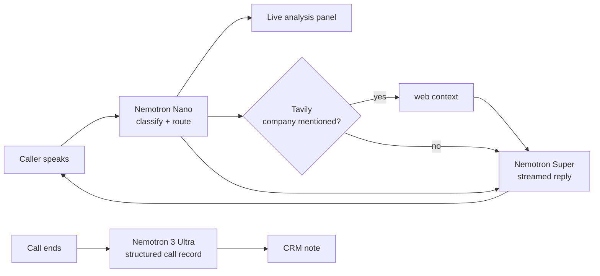

# CallLens
**Live call intelligence for support teams — three NVIDIA Nemotron tiers, one live call.**

Built for the [NVIDIA × Nebius Global AI Hackathon](https://nebius.ai) — *Best Apps and Agents* track.

[](LICENSE)

Speak into the mic and Aria answers out loud: browser speech recognition turns the
caller's voice into text, and the reply is read back through speech synthesis. No
telephony account, no phone number — the call runs entirely in the browser.


## The problem

A support agent on a live call has to listen, decide, look things up, stay polite and
remember everything — all at the same time. Teams solve this today with one big model
answering *every* turn, which is slow, expensive and still forgets to write the ticket
afterwards.

CallLens splits the job by urgency of the answer:

| Tier | NVIDIA model | Runs | Job | Budget |
| --- | --- | --- | --- | --- |
| **Nano** | Nemotron Nano | every turn, before the agent speaks | classify intent, sentiment, urgency, extract order id / company, pick the next action | ~100–200 ms |
| **Super** | Nemotron Super | every turn, streamed | the words the caller actually hears | ~1 s, token by token |
| **Ultra** | Nemotron 3 Ultra | once, after the line closes | structured call record + CRM note | operator-grade reasoning, latency no longer matters |

The point is not "use three models". The point is that **only one of them is on the
latency-critical path**, one is on the quality-critical path, and one runs when nobody
is waiting. Nano makes the UI feel instant, Super keeps the caller talking, Ultra does
the thinking that a human would do after hanging up.

A fourth, optional source: **Tavily** web search enriches the call when the caller
mentions a company, so the agent is not limited to whatever was baked into the prompt.

## What it looks like```text
┌──────────────────────────────────────────────┬──────────────────────┐
│  Aria · In call                     [live]   │  LIVE ANALYSIS   nano│
│                                              │  order_status        │
│  CALLER  Hi, where is my order ORD-1002?     │  sentiment frustrated│
│  ARIA    Order ORD-1002 is marked as …       │  urgency ▮▮▮▮        │
│                                              │  NEXT: read status   │
│  CALLER  Third time I am calling…            ├──────────────────────┤
│  ARIA    I am sorry for the wait. Order …    │  MODEL ROUTING       │
│                                              │  Nano   134ms        │
│                                              │  Super  1156ms       │
│                                              │  Ultra  —            │
└──────────────────────────────────────────────┴──────────────────────┘
```

Press **End call** and Ultra returns a summary, issue, resolution, follow-up and a
paste-ready CRM note.

## How it works



Everything the agent says is grounded in approved order and FAQ records
([`lib/data.mjs`](lib/data.mjs)). Anything outside those records is offered as a human
handoff instead of a guess — the same safety rule the Week 1 prototype enforced with
hard-coded rules, now enforced with a system prompt.

`POST /api/turn` returns **NDJSON** — one JSON object per line — so the browser can
render the classification, the web context and the reply deltas as separate events
from a single request:

```json
{"type":"analysis","model":"…-nano","ms":134,"data":{…}}
{"type":"speaking","model":"…-super"}
{"type":"delta","text":"Order "}
{"type":"done","model":"…-super","ms":1156}
```

## Quick start

Requires **Node.js 20.6+**. No build step, no runtime dependencies, no `node_modules`.

```bash
git clone <your-repo-url>
cd calllens
cp .env.example .env          # Windows: copy .env.example .env
npm start                     # http://localhost:3000
```

The app starts in **mock mode** if `NEBIUS_API_KEY` is empty, so you can click through
the whole flow before you have credentials. The badge in the top right always says
which mode you are in — mock mode is never presented as a live model.

### Connect Nebius Token Factory

1. Create an API key in [Nebius Studio](https://studio.nebius.ai) → *Token Factory*.
2. Put it in `.env` as `NEBIUS_API_KEY=…`.
3. List the models your key can see — **do not guess model ids**:
   ```bash
   npm run models
   ```
4. Copy the Nano / Super / Ultra ids into `NEBIUS_MODEL_FAST`, `NEBIUS_MODEL_MAIN`,
   `NEBIUS_MODEL_DEEP`. Restart. The badge turns green: `Token Factory · live`.

Optional: add `TAVILY_API_KEY` to enable the web-context panel.

Check the backend at any time:

```bash
curl http://localhost:3000/health
```

## Deploy a public demo

**Render** (free tier, no Docker needed) — *New → Web Service → connect the repo*:

| Setting | Value |
| --- | --- |
| Build command | `npm install` (no dependencies, but harmless) |
| Start command | `npm start` |
| Environment | `NEBIUS_API_KEY`, `NEBIUS_MODEL_FAST`, `NEBIUS_MODEL_MAIN`, `NEBIUS_MODEL_DEEP` |

**Docker** (any host):

```bash
docker build -t calllens .
docker run -p 3000:3000 --env-file .env calllens
```

## Running a demo call

Paste these in order — this is the script used in the demo video:

1. `Hi, where is my order ORD-1002?`
   → Nano tags `order_status`, Super reads the approved record, order id appears in the rail.
2. `This is the third time I am calling. It was meant to arrive on the 2nd.`
   → sentiment flips to `frustrated`, urgency rises, the order id carries over from the previous turn.
3. `I want to speak to a human right now.`
   → `escalate` badge appears, Super hands off in one sentence.
4. **End call** → Ultra writes the record, risk level and CRM note, ready to copy.

## Project layout

```text
server.mjs              HTTP server, NDJSON turn stream, summary endpoint, static files
lib/nebius.mjs          Token Factory client (streaming + JSON parsing + modes)
lib/prompts.mjs         the three system prompts — the actual product logic
lib/mock.mjs            offline stand-in so the UI works without a key
lib/data.mjs            approved (fictional) orders, hours and FAQs
lib/tavily.mjs          optional web context, fails soft
public/                 the console: index.html, styles.css, app.js
scripts/check-models.mjs  prints model ids available to your key
scripts/build_report.py   regenerates REPORT.docx from REPORT.md
REPORT.md / REPORT.docx   the full written project report
```

To rebuild the report document:

```bash
pip install -r requirements-dev.txt
python scripts/build_report.py
```

## Design decisions

- **No framework, no build.** One Node process and three static files. A judge can
  clone, run one command and see it work; there is no toolchain that can break.
- **Streaming over polling.** The reply is token-streamed so the console feels like a
  live call rather than a form submission.
- **The UI is the product.** The right rail is not decoration: it is the second model
  tier's output made visible, which is what a supervisor would actually watch.
- **Grounding over creativity.** The reply prompt is given a closed knowledge block and
  told that anything outside it becomes a handoff. The sample data is fictional and
  clearly labelled.

## What changed during the hackathon

This project is the Week 2–3 evolution of a Week 1 internship prototype
(`AI Customer Calling Agent`) that used hand-written keyword rules, a Python CLI and no
LLM at all. During the submission period:

| Week 1 prototype | CallLens (this repo) |
| --- | --- |
| Python, standard library | Node.js, zero dependencies |
| Keyword/regex intent detection | Nemotron Nano classification, one call per turn |
| Hard-coded reply templates | Nemotron Super, streaming, grounded in a closed knowledge block |
| No post-call artefact | Nemotron 3 Ultra structured record + CRM note |
| Terminal chat | Browser console with live analysis rail |
| No external context | Optional Tavily enrichment |
| 27 unit tests, no live model | Real Token Factory calls with a mock fallback |

The domain, the approved sample data and the "never guess, hand off instead" rule were
carried over deliberately — the upgrade is the intelligence layer, not the use case.

## Limitations — stated honestly

- **Voice is browser-native, not telephony.** The mic button uses the Web Speech API
  (Chrome/Edge) for speech-to-text, and replies are read aloud with `speechSynthesis`.
  There is no phone number, no SIP trunk, no Twilio — a real line is the next step.
- **One call at a time**, no auth, no persistence. Refreshing clears the session.
- **Sample data only.** Nothing here is a real customer or a real company.
- Mock mode is keyword-based by design; it exists so the UI can be developed offline,
  not to imitate model quality.

## Using NVIDIA and Nebius

- **Nebius Token Factory** serves every model call, through its OpenAI-compatible
  `/chat/completions` endpoint ([`lib/nebius.mjs`](lib/nebius.mjs)) — including
  streamed responses, which is what makes the console feel live.
- **NVIDIA Nemotron** does all of the reasoning, split across three size classes so
  latency, quality and cost land where they belong.
- Model ids are configuration, not code: any Nemotron variant can be swapped in
  without touching a line of application logic.

## License

Apache 2.0 — see [LICENSE](LICENSE).


